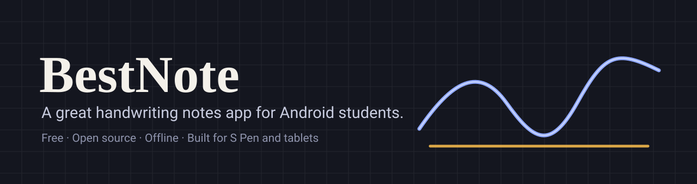
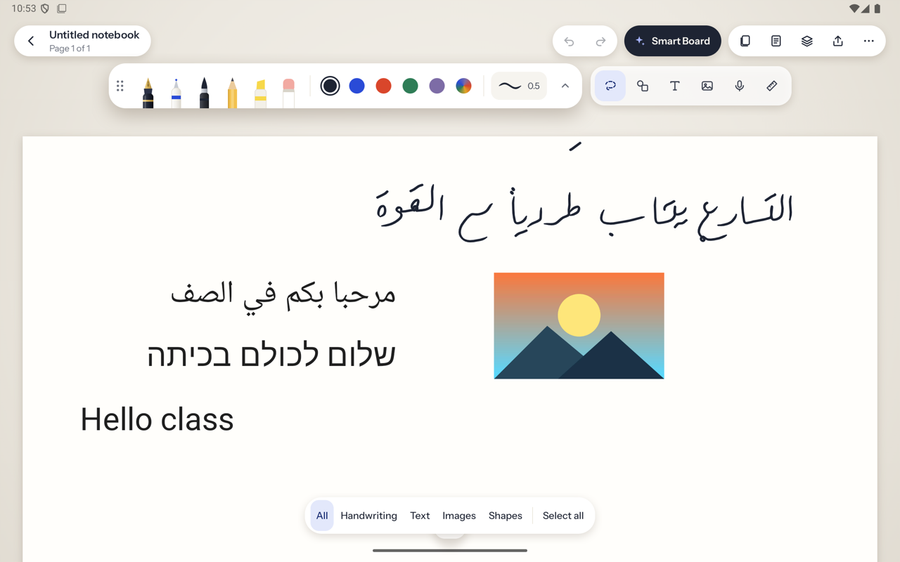
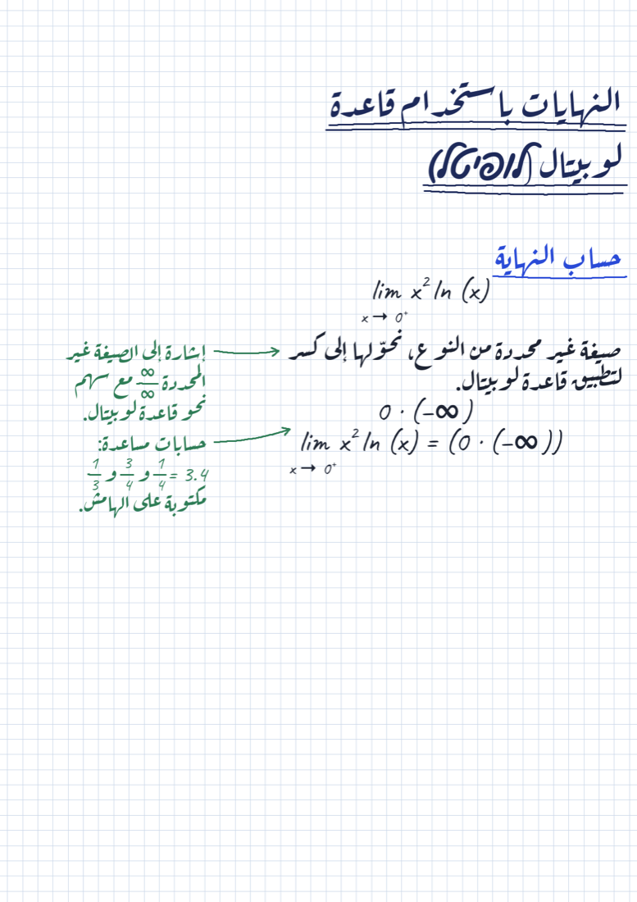
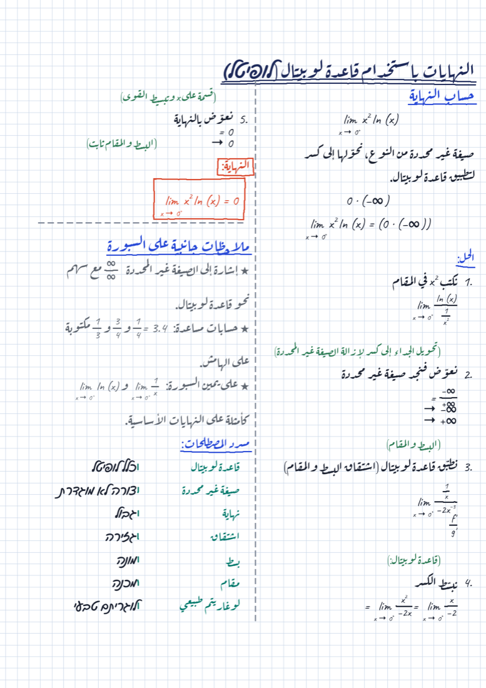
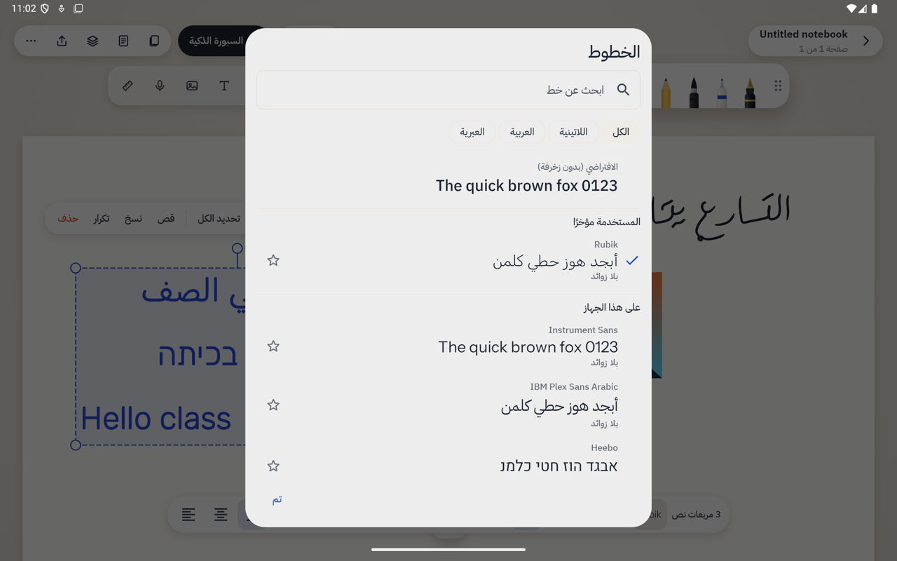
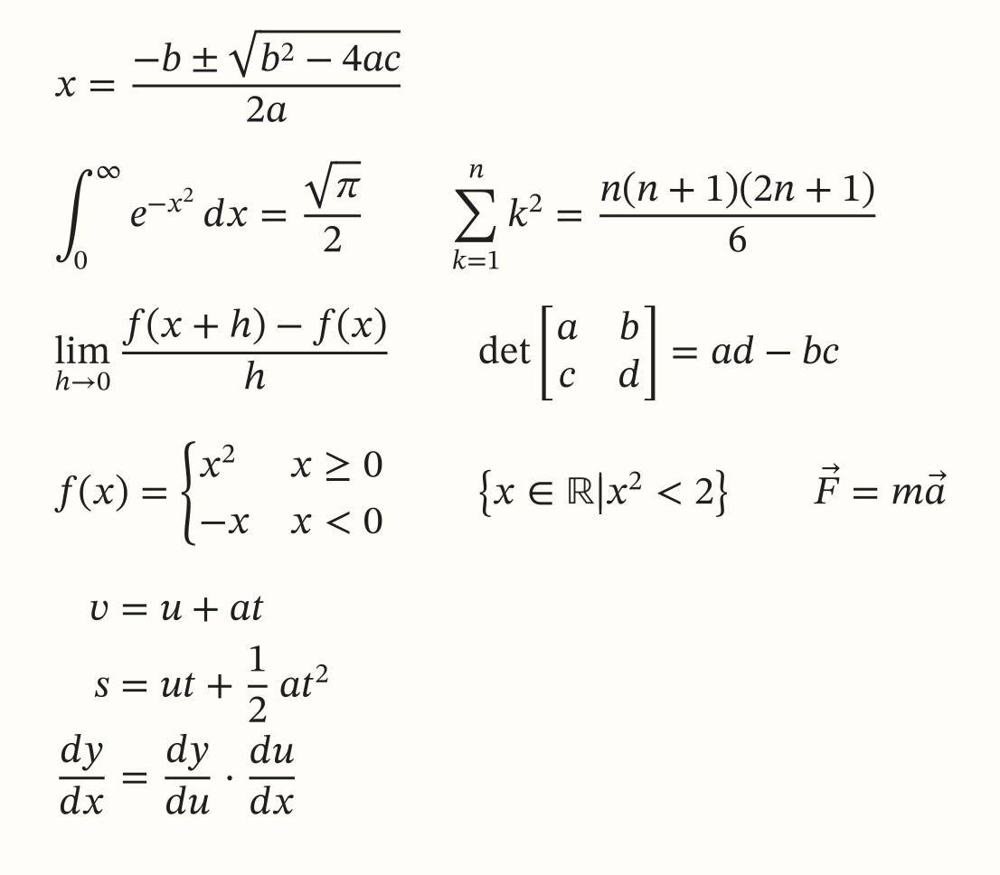
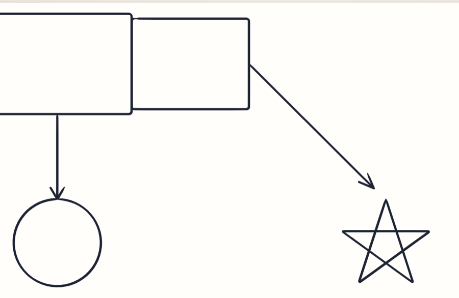
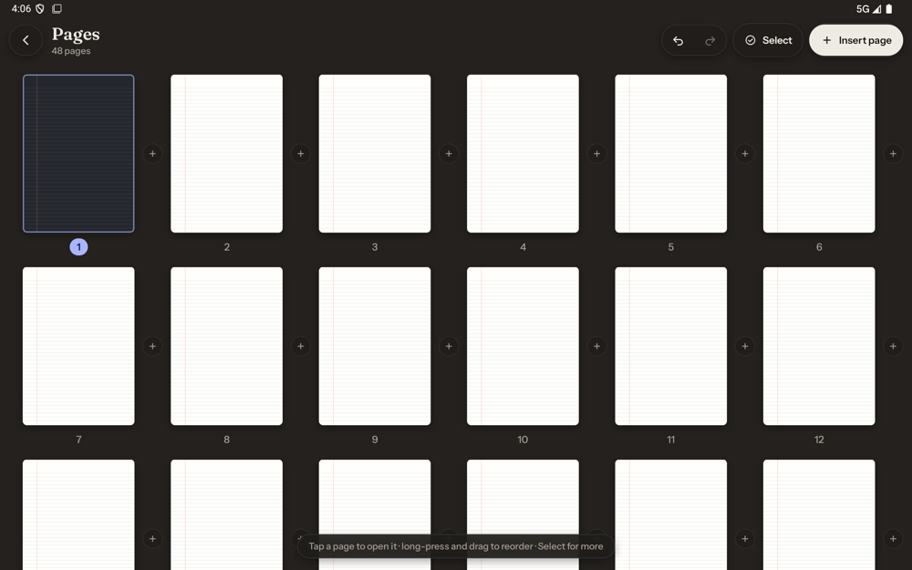
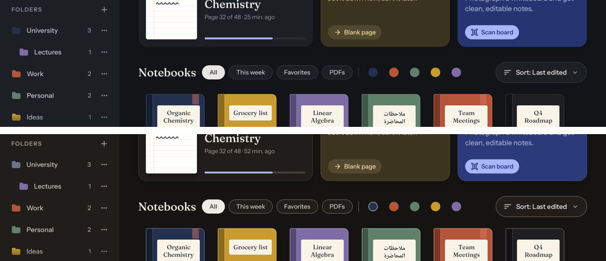

<p align="center">
  
</p>

<p align="center">
  <a href="LICENSE"></a>
  <a href="https://github.com/alidiab2/BestNote/releases"></a>
  
  
  <a href="CONTRIBUTING.md"></a>
</p>

<h3 align="center">The note-taking app Android students deserve.<br>Free, open source, offline, and built around the pen.</h3>

<p align="center">
  <a href="https://github.com/alidiab2/BestNote/releases/latest"><b>Download the latest build</b></a> ·
  <a href="docs/product/vision.md">Vision</a> ·
  <a href="docs/roadmap.md">Roadmap</a> ·
  <a href="CONTRIBUTING.md">Contribute</a>
</p>

<p align="center">
  
</p>

## Our goal

**Build a really good notes app for students on Android.**

Students on iPad have excellent handwriting apps. On Android there are very few good ones: most are closed, tied to one brand, or feel like ports. BestNote is an open, community-built answer. We want a student with a Galaxy Tab (or any Android tablet or phone) to run a whole semester in it: lectures, PDF slides, formulas, diagrams, and revision, in any language, without an account, ads or a subscription.

If you are a student, a developer, a designer, or someone who just loves good tools, **this project is for you and we want your help.**

## What makes it different

<table>
<tr>
<td width="50%" valign="top">

### Ink that feels right
Pressure-sensitive pens (fountain, ball, brush, pencil, highlighter), tuned for the Samsung S Pen: low latency, palm rejection, hover cursor, side-button eraser.

### Arabic and RTL are first class
Arabic, Hebrew and English side by side on one page. Right-to-left UI and a font picker that understands Arabic scripts.

### Your notes stay yours
No account, no ads, no tracking, no paywall. Works fully offline. Open file format and export.

</td>
<td width="50%" valign="top">

### Smart Board
Photograph a whiteboard and get clean, ordered study notes with straight diagrams, meaningful colors and equations. Opt-in and bring your own AI key; the core app never needs the network.

### Built for studying
Equations, shapes that stay connected when you move them, lasso selection, a page manager and dark mode. PDF annotation and more are on the [roadmap](docs/roadmap.md).

### Open and hackable
Modular Kotlin and Jetpack Compose codebase with documented architecture, numbered tasks and a clear contribution flow.

</td>
</tr>
</table>

## See it

### Smart Board: whiteboard photo in, study notes out
Real output from the current builds, on an Arabic calculus lecture.

<table>
<tr>
<td align="center" width="50%"><br><sub>It writes the page the way a student would</sub></td>
<td align="center" width="50%"><br><sub>Finished page: headings, colors, equations, glossary</sub></td>
</tr>
</table>

### Everything you need on the page
<table>
<tr>
<td align="center" width="50%"><br><sub>Fonts for Arabic, Latin and Hebrew</sub></td>
<td align="center" width="50%"><br><sub>Typeset equations</sub></td>
</tr>
<tr>
<td align="center"><br><sub>Shapes and connectors that follow when you move them</sub></td>
<td align="center"><br><sub>Page manager, dark mode</sub></td>
</tr>
</table>

<p align="center">
  <br>
  <sub>The notebook library in dark mode. Dark mode is a first-class citizen.</sub>
</p>

## Status

**Early and moving fast.** The app already builds, writes, and ships test builds (latest: see [Releases](https://github.com/alidiab2/BestNote/releases)). It is **not 1.0 yet**: expect rough edges. Milestones and what is done are in the [roadmap](docs/roadmap.md).

## Try it

1. Go to [Releases](https://github.com/alidiab2/BestNote/releases/latest) and download the `.apk`.
2. Allow "Install unknown apps" for your browser or file manager when Android asks.
3. Open BestNote and start writing. Best on a Galaxy Tab with an S Pen, but any Android device works.

## Help us build it

You do not need to ask permission, just pick something:

- **Pick a task.** [`docs/workstreams/`](docs/workstreams/) has 12 workstreams with numbered, sized tasks (like `INK-03`) and clear "done" criteria.
- **Test and report.** Try a build on your device and open an issue. Different tablets and S Pen models are very valuable.
- **Design.** Interactive mockups live in [`design/`](design/). Propose improvements.
- **Translate.** Arabic is in; more languages are welcome.
- **Students: tell us what you need.** Real study workflows decide what we build next.

Start with [CONTRIBUTING.md](CONTRIBUTING.md). Questions and ideas are welcome in Issues.

## Build from source

Requires JDK 17 and Android SDK platform 37.

```bash
git clone https://github.com/alidiab2/BestNote.git
cd BestNote
./gradlew assembleDebug test
./gradlew :app:installDebug
```

## Project map

| Where | What |
|---|---|
| [`docs/product/`](docs/product/) | Vision, Goodnotes → BestNote feature matrix |
| [`docs/roadmap.md`](docs/roadmap.md) | Milestones M0–M4, exit criteria, open decisions |
| [`docs/workstreams/`](docs/workstreams/) | **Start here to pick work:** 12 workstreams with numbered tasks |
| [`docs/architecture/`](docs/architecture/) | Module layout, stroke pipeline, file format, ADRs |
| [`docs/platform/samsung-s-pen.md`](docs/platform/samsung-s-pen.md) | S Pen / Galaxy tablet spec + device matrix |
| [`docs/design/`](docs/design/) | UI, motion and haptics principles |
| [`docs/release.md`](docs/release.md) | How builds are published and how in-app updates work |
| [`CONTRIBUTING.md`](CONTRIBUTING.md) | Workflow, branches, definition of done |

<details>
<summary><b>Modules</b></summary>

| Layer | Modules |
|---|---|
| App | `:app` |
| Features | `:feature:library` · `:feature:editor` · `:feature:settings` · `:feature:smartboard` · `:feature:onboarding` · `:feature:templates` |
| Engine | `:engine:canvas` · `:engine:ink` · `:engine:stylus` · `:engine:pdf` · `:engine:recognition` · `:engine:layout` · `:engine:templates` · `:engine:export` |
| AI (opt-in) | `:ai:vision-api` · `:ai:vision-providers` · `:ai:math` · `:ai:board-scan` |
| Core | `:core:model` · `:core:common` · `:core:storage` · `:core:database` · `:core:datastore` · `:core:designsystem` · `:core:ui` · `:core:updater` |

Dependency direction: `app → feature → engine → core`. Details in the [architecture overview](docs/architecture/overview.md).

</details>

## License

[MIT](LICENSE). Use it, learn from it, fork it, improve it.
